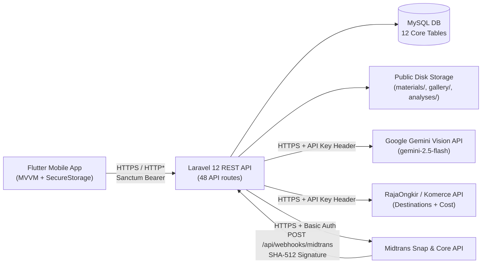

# Plasvora — Executive Audit Summary & Senior Engineer Review

**Audit Date:** 2026-11-25  
**Scope:** Full-stack read-only technical, security, code quality, database, business logic, and AI implementation audit  
**Repositories Audited:**
- **Flutter Frontend (`FE`):** `C:\Project\Plasvora_app` (branch `feature/gallery`)
- **Laravel Backend (`BE`):** `C:\xampp\htdocs\backend_plasvora` (branch `feature/gallery`)

**Audit Documentation Placement:**
- Master full-stack audit suite (all 7 reports): `C:\Project\Plasvora_app\docs\audit\`
- Backend index & backend-specific finding tracker: `C:\xampp\htdocs\backend_plasvora\docs\audit\README.md` (cross-linked without verbatim duplication)

**Audit Integrity Statement:** No application source code, configurations, migrations, `.env` files, dependencies, or Git history were modified during this audit. No `.env` contents, secrets, or credentials were printed or exposed. Findings are strictly grounded in directly inspected source code and observed command output; blocked checks (e.g., MySQL-backed PHPUnit feature tests) are reported explicitly rather than assumed to pass.

---

## 1. Overall Condition Assessment

| Audit Dimension | Current Rating | Summary |
|---|---|---|
| **Backend Architecture & Transactional Core** | **Strong (with targeted gaps)** | Checkout, Midtrans Snap/Webhook reconciliation, RajaOngkir shipping, address locking, and Gallery policy/validation show disciplined senior-level engineering (row-level locking, server-authoritative pricing, constant-time SHA-512 webhook verification, idempotency keys). Gaps exist in token lifetime, rate-limiting coverage on non-payment routes, Smart Matching authorization/logic, private analysis photo exposure, and 9 Composer advisories. |
| **Frontend Architecture & Runtime Reliability** | **Needs Remediation Before Release** | Clean MVVM + Repository separation and zero `lib/` analyzer errors, but **2 critical user-facing regressions** (login failures routing to a 403 Forbidden screen; Analysis dropdown sending `'1'`–`'7'` rejected with HTTP 422 by Laravel), **cross-account in-memory data leakage on logout**, **6 failing widget tests**, and **debug-signed / cleartext-enabled release config**. |
| **Security Posture** | **Not Production-Ready Yet** | Strong payment webhook and TLS CA fundamentals are undercut by release-blocking mobile issues (`usesCleartextTraffic="true"`, debug keystore signing, incomplete logout wipe), backend supply-chain CVEs (9 Composer advisories), unauthenticated public disk storage for private analysis photos, and BOLA/missing status checks on Smart Matching endpoints. |
| **AI Implementation Honesty & Technical Soundness** | **Partially Sound — Copy/Safety Fixes Required** | Real external generative AI (**Google Gemini Vision API**, `gemini-2.5-flash` with `gemini-2.5-flash-lite` fallback) genuinely powers plastic photo analysis. Smart Matching is genuinely and transparently deterministic rule-based scoring. However, several UI/copy elements **overstate or misstate AI claims** (`AI Vision v2.4` badge shown even in rule-based mode, `"Analisis AI"` logged for demo runs, unverified CO₂ `avoided_emission` claims, `"Bulan ini"` label on all-time totals), and a **JPEG/MIME mismatch bug** breaks compressed PNG/WebP vision requests. |
| **Automated Test Health** | **Mixed / Partially Blocked** | Flutter: **161 passed, 6 failed** (`flutter analyze`: 0 errors, 2 test warnings). Laravel: **17/22 unit tests passed** (all 16 `MidtransServiceTest` + `ExampleTest` passed); **5 unit DB tests and all 16 Feature test suites could not run** because local MySQL (`127.0.0.1:3306`) is stopped. |

**Release Readiness Verdict:** **NO-GO for public production or Play Store release** until P0 blockers (broken login error flow, broken polymer dropdown contract, cleartext/debug release build config, cross-account logout wipe, Composer security updates, and the 6 failing Flutter tests) are resolved. **CONDITIONAL-GO for supervised competition demo** if the P0 login/analysis bugs and misleading AI/impact labels are patched first.

---

## 2. System Architecture & Component Map

### Repositories & Technology Stack
- **Frontend (`C:\Project\Plasvora_app`):** Flutter / Dart (`sdk: ^3.10.0`), manual dependency injection in `lib/main.dart`, MVVM with `ChangeNotifier` + `ListenableBuilder`, Repository pattern (`Api*` vs `Mock*` toggled by `--dart-define=USE_API=true`), `http` + `IOClient` (bundled ISRG Root X1 CA), `flutter_secure_storage` (`9.2.4`), `image_picker`, `url_launcher`.
- **Backend (`C:\xampp\htdocs\backend_plasvora`):** Laravel `v12.70.1` (PHP `8.2.12`), Sanctum `v4.3.3` Bearer tokens, Eloquent ORM + MySQL (`12` core business tables + Laravel system tables), `ext-gd` for image compression, external HTTP integrations via Laravel `Http` facade (Guzzle `7.16.1`).

### High-Level Data & Trust Flow

*\*Release `AndroidManifest.xml` currently allows cleartext HTTP globally (`SEC-FE-01`).*

---

## 3. Finding Counts by Category & Severity

| Category | Critical | High | Medium | Low | Info / Needs Validation |
|---|---:|---:|---:|---:|---:|
| **Confirmed Security Vulnerabilities** ([01-SECURITY-FINDINGS.md](01-SECURITY-FINDINGS.md)) | 0 | 4 | 9 | 5 | 2 (`needs_validation`) |
| **Confirmed Functional Bugs** ([02-BUGS-AND-CODE-QUALITY.md](02-BUGS-AND-CODE-QUALITY.md)) | 2 | 4 | 7 | 4 | — |
| **AI & Claim Integrity Findings** ([03-AI-IMPLEMENTATION-AUDIT.md](03-AI-IMPLEMENTATION-AUDIT.md)) | 0 | 3 | 5 | 2 | — |
| **Database & Business Logic Issues** ([04-DATABASE-AND-BUSINESS-LOGIC.md](04-DATABASE-AND-BUSINESS-LOGIC.md)) | 0 | 1 | 6 | 3 | — |
| **Dependency / Build / Test Blockers** ([05-TEST-AND-DEPENDENCY-RESULTS.md](05-TEST-AND-DEPENDENCY-RESULTS.md)) | — | 2 | 2 | 2 | 1 blocker (MySQL stopped) |

---

## 4. Top Risks & Immediate Priorities

### Top 7 Highest-Impact Findings
1. **`BUG-01` [CRITICAL, FE]:** Any login or registration failure sets `AuthState.error`, which `PlasvoraApp` (`lib/main.dart:304-386`) intercepts and replaces with a full-screen **"403 Akses Dibatasi"** screen, unmounting `LoginScreen` and swallowing the actual error message.
2. **`BUG-02` [CRITICAL, FE+BE Contract Mismatch]:** `AnalysisScreen` (`lib/views/analysis/analysis_screen.dart:428-455`) submits numeric resin codes `'1'`–`'7'` as `declared_category`, while `AnalysisController.php:79` only accepts `['PET', 'HDPE', 'PP', 'LDPE', 'OTHER', 'MIXED']`, guaranteeing HTTP 422 whenever a user selects any category.
3. **`SEC-FE-01` & `SEC-FE-02` [HIGH, FE]:** Main `AndroidManifest.xml:6` enables `android:usesCleartextTraffic="true"` for release builds, and `android/app/build.gradle.kts:36` signs `release` builds with the Android `debug` keystore under placeholder `com.example.plasvora`.
4. **`SEC-FE-03` [HIGH, FE]:** Logout (`lib/main.dart:89-93`, `profile_screen.dart:102-104`) wipes only 3 ViewModels (`Address`, `Order`, `Gallery`), leaving User A's private data cached in `ActivityViewModel`, `AnalysisViewModel`, `MatchingViewModel`, `ApiMaterialRepository._favoriteIds`, `MaterialRequestViewModel`, and `MarketplaceViewModel` — plus async in-flight race gaps in `AddressViewModel` and `GalleryViewModel`.
5. **`SEC-BE-08` [HIGH, BE Supply Chain]:** `composer audit` reports **9 published security advisories across 6 locked packages** (`laravel/framework v12.70.1`, `symfony/http-foundation v7.4.21`, `symfony/http-kernel v7.4.21`, `symfony/mime v7.4.19`, `symfony/routing v7.4.21`, `symfony/yaml v7.4.21`).
6. **`AI-BUG-01` & `AI-SAFE-01` [HIGH, BE+FE]:** `GeminiVisionService` re-encodes large PNG/WebP uploads to JPEG bytes while leaving `inlineData.mimeType` as `image/png` or `image/webp`; meanwhile Flutter's `AnalysisResultScreen` displays hardcoded `'AI Vision v2.4'` even in simulated mode, displays unverified CO₂ claims, and recommends melting plastic in client fallback ideas with `safetyNotes: null`.
7. **`TEST-FE-01` [HIGH, FE]:** **6 of 167 Flutter tests fail**, including a real runtime `FlutterError` assertion in `CreateGalleryWorkScreen` (`CheckboxListTile` wrapped in a colored `Container` instead of `Material`) and a `setState() called during build` error in `MyGalleryWorksScreen`.

### Immediate Priority Actions (Do Not Skip)
- **P0 (Before any demo or staging build):** Fix `BUG-01` (login error routing), `BUG-02` (`declared_category` mapping), `BUG-12`/`BUG-13` (Gallery Flutter framework assertions failing 4 widget tests), and `SEC-FE-03` (centralized session reset across all stateful ViewModels/repositories).
- **P1 (Before any release APK or public deployment):** Harden release Android config (`SEC-FE-01`, `SEC-FE-02`, `SEC-FE-05`), run `composer update` for the 9 security advisories (`SEC-BE-08`), move private `analyses/` images off public disk and clean up orphans (`SEC-BE-04`), fix `GeminiVisionService` MIME mismatch + prompt delimiters + safety warnings (`AI-BUG-01`, `AI-SEC-01`, `AI-SAFE-01`), fix Smart Matching BOLA + self-matching + location bugs (`SEC-BE-03`, `AI-MATCH-01`), and add Sanctum token expiration + missing route rate limiters (`SEC-BE-01`, `SEC-BE-02`).

---

## 5. Final Senior Engineer Review

### What Is Genuinely Well-Engineered
1. **Transactional Checkout & Payment Reconciliation (`OrderService.php`, `MidtransService.php`, `MidtransWebhookController.php`):** This is the strongest subsystem in the entire codebase. Server-authoritative price/weight/shipping calculation, atomic `lockForUpdate()` reservation on `MaterialListing` *without* holding DB locks across external HTTP calls, dedicated `MIDTRANS_SIGNATURE_SECRET_KEY` (no silent Server Key fallback), constant-time `hash_equals` SHA-512 signature verification, SHA-256 `payload_hash` deduplication without storing raw webhook PII, monotonic state transitions, and pre-payment buyer PII redaction for sellers are all production-grade patterns.
2. **Honest Separation of Smart Matching from AI:** Unlike many student/competition apps that brand simple `if/else` scoring as "AI," Plasvora's `MaterialMatchingService` and `MatchingResultsScreen` explicitly disclose that matching is a deterministic 40/30/20/10 rule-based backend score and not AI probability.
3. **Gallery Domain Hardening (`GalleryWorkController.php`, `AllowedVideoUrl.php`):** Strict HTTPS + host allowlist + credential-stripping URL validation, explicit mass-assignment protection (`user_id`, `status`, `likes_count` excluded from `$fillable`), `addcslashes` wildcard escaping on search, and atomic like counter updates under `lockForUpdate()`.
4. **Mobile Secret & TLS Discipline:** Zero Gemini/Midtrans/RajaOngkir keys in Flutter, bundled ISRG Root X1 CA without overriding OS roots or disabling TLS verification (`badCertificateCallback` absent), strict Midtrans Snap URL allowlist, and local-first fail-safe logout.

### Where Technical Debt & Risks Concentrate
1. **Rapid Feature-Layer Drift Between Frontend & Backend:** Newer subsystems (Orders, Gallery) were built with much higher rigor than earlier subsystems (Auth error state routing, Analysis dropdown values, Activity auto-loading, MaterialRequest `currentUserId` wiring, Handover legacy endpoints).
2. **Cross-Cutting State Lifecycle Gaps on Mobile:** Manual DI in `main.dart` creates 11 long-lived ViewModels/repositories, but session teardown (`clearUserData()`) was only wired to the 3 most recently built ViewModels.
3. **Unfinished Safety & Claim Polish on AI/Impact Surfaces:** The AI pipeline works with real Gemini Vision, yet leftover mockup copy (`AI Vision v2.4`, `"Bulan ini"`, `"Pemrosesan citra aman & tidak disebarluaskan"`, unverified CO₂ figures, and a melting fallback idea with `safetyNotes: null`) creates unnecessary credibility and safety liabilities in front of a technical jury.
4. **Release Engineering & Supply-Chain Hygiene:** Debug keystore release signing, global cleartext traffic, omitted `allowBackup="false"`, 9 unpatched Composer advisories, and an outdated SQL dump committed in Git are classic pre-release gaps that are easy to fix once surfaced.

---

## 6. Questions a Senior Software Engineer Might Ask (18 Code-Grounded Q&As)

### Architecture & Reliability

**Q1. Why does `OrderService::createOrder()` call RajaOngkir and Midtrans *outside* `DB::transaction()`, and how do you handle drift between the shipping quote and the DB lock?**
- **Why it matters:** Holding InnoDB `SELECT ... FOR UPDATE` row locks across slow external HTTP calls causes lock contention, pool exhaustion, and deadlocks under concurrency.
- **Codebase detail:** `OrderService.php:74-172` queries RajaOngkir before the transaction, then re-validates `origin_destination_id`, `weight_grams`, `item_price`, and buyer `destination_id` inside `lockForUpdate()`, aborting with HTTP `409` if anything changed mid-flight; Midtrans Snap runs after commit (`L291`).
- **Evidence needed / Gap:** Good design overall. However, if Midtrans Snap times out after DB commit (`L1395-1406`), an idempotent retry of `POST /api/orders` returns `200` with `snap_token: null` (`L1241-1263`), requiring the client to invoke `/retry-payment`.
- **Suggested answer:** *"We deliberately keep external HTTP calls outside DB transactions to avoid lock-wait timeouts. We re-verify immutable price/weight/route invariants inside `lockForUpdate()` and use client-supplied `idempotency_key` + `/retry-payment` to recover safely from ambiguous Snap timeouts without releasing the listing reservation prematurely."*

**Q2. What happens when a user enters the wrong password on `LoginScreen` right now?**
- **Why it matters:** Core auth UX reliability — if broken, users cannot distinguish a typo from an account ban.
- **Codebase detail:** `AuthViewModel.login()` (`lib/viewmodels/auth_viewmodel.dart:109-113`) sets `_state = AuthState.error`. `PlasvoraApp` (`lib/main.dart:304-386`) listens to `authViewModel` and swaps `LoginScreen` out for a full-screen `"Akses Dibatasi (403 Forbidden)"` error screen.
- **Evidence needed:** Reproduce with any invalid credentials or trace `auth_viewmodel.dart:109` -> `main.dart:304`.
- **Suggested answer:** *"That is a confirmed P0 defect identified in this audit. `AuthState.error` should be reserved exclusively for fatal startup/session-check errors (like 403/500 during cold boot), while interactive login/register form errors should keep `_state = AuthState.unauthenticated` and expose `errorMessage` inline on `LoginScreen`/`RegisterScreen`."*

**Q3. How do you guarantee that unpaid orders eventually release their `reserved` listings back to `available`?**
- **Why it matters:** Without automated expiry reconciliation, abandoned checkouts permanently lock seller inventory.
- **Codebase detail:** `ExpireUnpaidOrdersCommand` (`orders:expire-unpaid`) is scheduled every 5 minutes in `routes/console.php:13-15` with `withoutOverlapping()`, and `OrderService::processExpiredCandidate()` checks Midtrans GET Status before expiring so paid-but-unnotified orders are promoted to `paid` rather than wrongly expired.
- **Evidence needed / Gap:** In local XAMPP or production deployment, Laravel's scheduler (`php artisan schedule:run` cron or `schedule:work`) MUST be actively running; otherwise `routes/console.php` never fires.
- **Suggested answer:** *"We implemented a safe two-phase expiry command (`orders:expire-unpaid`) scheduled every 5 minutes that verifies authoritative payment state with Midtrans before releasing any listing. In deployment, we must provision a system cron/supervisor entry running `php artisan schedule:run` every minute."*

**Q4. Why do both `HandoverRequest` and `Order` exist on `MaterialListing`, and can they double-book a listing or double-count environmental impact?**
- **Why it matters:** Dual fulfillment channels on a single lot are a classic source of double-selling and inflated metrics.
- **Codebase detail:** Both `OrderService::createOrder()` (`L175-188`) and `HandoverRequestController::store()` / `updateStatus()` (`L83-96, 240-251`) lock `MaterialListing` and reject conflicting active orders/handovers. `ImpactSummaryController.php:57-69` excludes `listing_id`s already counted via handover from completed orders.
- **Evidence needed / Gap:** `HandoverRequestController::store()` never checks `$listing->is_free`, so handovers can still be requested on paid listings even though `OrderService` rejects free listings. Also `UpdateHandoverStatusRequest` puts no upper bound on `actual_weight_kg`.
- **Suggested answer:** *"Cross-channel locking prevents double-booking and `ImpactSummaryController` deduplicates by `listing_id`. However, we should enforce `$listing->is_free === true` in `HandoverRequestController::store()` (or document if paid handovers are intentional) and cap `agreed_weight_kg`/`actual_weight_kg` against `listing->weight_kg`."*

**Q5. Why did `AnalysisScreen` fail with HTTP 422 when selecting a plastic category from the dropdown?**
- **Why it matters:** Contract drift between mobile client and backend API breaks a flagship feature.
- **Codebase detail:** `analysis_screen.dart:428-455` emits `'1'`–`'7'`, while `AnalysisController.php:79` validates `Rule::in(['PET', 'HDPE', 'PP', 'LDPE', 'OTHER', 'MIXED'])`.
- **Suggested answer:** *"The Flutter dropdown values were left as numeric resin codes `'1'`–`'7'` while the backend enum expects canonical polymer strings (`PET`, `HDPE`, `PP`, `LDPE`, `OTHER`, `MIXED`). Aligning the dropdown values (and mapping PVC/PS to `OTHER` or expanding the enum) resolves this cleanly."*

### Security & Privacy

**Q6. Is your Midtrans webhook endpoint protected against forged payment notifications, replay attacks, and amount tampering?**
- **Why it matters:** Forging a `settlement` webhook lets an attacker mark unpaid orders as `paid` for free.
- **Codebase detail:** `MidtransWebhookController.php` verifies SHA-512(`order_id + status_code + gross_amount + MIDTRANS_SIGNATURE_SECRET_KEY`) using `hash_equals()`, refuses fallback to `server_key`, deduplicates via unique `payload_hash` (`SHA-256`) in `payment_webhook_events`, and `OrderService::reconcilePayment()` verifies `order_id`, `currency === 'IDR'`, and exact integer `gross_amount === total_amount` via `RupiahAmount::parseExactWhole()`.
- **Suggested answer:** *"Yes—webhooks require a dedicated `MIDTRANS_SIGNATURE_SECRET_KEY`, constant-time SHA-512 verification, payload-hash idempotency, and exact integer Rupiah amount matching inside a locked transaction, and we never trust client-supplied prices or statuses."*

**Q7. If User A logs out on a shared Android phone and User B logs in, can User B see any of User A's data?**
- **Why it matters:** Cross-account leakage is a high-severity privacy defect on mobile devices.
- **Codebase detail:** `main.dart:89-93` and `profile_screen.dart:102-104` only clear `addressViewModel`, `orderViewModel`, and `galleryViewModel`. `ActivityViewModel` (`_activities`, `_analyses`), `AnalysisViewModel` (local photo & result), `MatchingViewModel`, `ApiMaterialRepository._favoriteIds`, `MaterialRequestViewModel`, and `MarketplaceViewModel` retain User A's state. Moreover, `ActivityScreen` does not refresh on mount.
- **Suggested answer:** *"Currently yes—several ViewModels are not cleared on logout, and `AddressViewModel`/`GalleryViewModel` mutations lack session-version guards for in-flight requests. We need a single centralized `SessionResetCoordinator` invoked on logout, account switch, and global 401 expiry."*

**Q8. Why are user analysis photos stored on Laravel's `public` disk when `GET /api/analyses/{id}` enforces strict owner-only authorization?**
- **Why it matters:** Serving private user photos via predictable/direct `/storage/analyses/...` URLs bypasses the API authorization boundary and contradicts the UI's `"tidak disebarluaskan"` privacy promise.
- **Codebase detail:** `AnalysisController.php:116` calls `$request->file('image')->store('analyses', 'public')`, and on Gemini exception (`L175-184`) never deletes the uploaded file.
- **Suggested answer:** *"Storing private analysis uploads on the `public` disk is a confirmed medium-severity security gap. They should be moved to the `local` (private) disk, served via an authenticated owner-checked endpoint (or short-lived signed URL), and deleted in the `catch` block if analysis persistence fails."*

**Q9. Can an authenticated user query Smart Matching for someone else's cancelled or inactive records?**
- **Why it matters:** Broken Object Level Authorization (BOLA) leaks business intelligence and lets users probe non-public states.
- **Codebase detail:** `MatchingController.php:23-96` loads `MaterialRequest::find($id)` and `MaterialListing::find($id)` with zero ownership or active-status check.
- **Suggested answer:** *"Currently `MatchingController` lacks both status filtering (active/available) and ownership/visibility validation. We should verify status and enforce authorization before invoking `MaterialMatchingService`, plus exclude self-owned candidates from match results."*

**Q10. Your Android app ships `isrgrootx1.pem` — did you disable TLS certificate verification anywhere, and why is `usesCleartextTraffic="true"` in `AndroidManifest.xml`?**
- **Why it matters:** Insecure TLS or cleartext HTTP exposes Bearer tokens and PII to local network MITM attacks.
- **Codebase detail:** `ApiClient` properly keeps OS default roots (`withTrustedRoots: true`) and adds ISRG Root X1 for older Android devices, with zero `badCertificateCallback` overrides. However, `android/app/src/main/AndroidManifest.xml:6` globally sets `android:usesCleartextTraffic="true"` and `api_config.dart:7` defaults to `http://127.0.0.1:8000/api`.
- **Suggested answer:** *"TLS validation is never bypassed in Dart, and we bundle only the public Let's Encrypt root CA. However, `usesCleartextTraffic="true"` must be moved strictly to `android/app/src/debug/AndroidManifest.xml` (or a debug-only `network_security_config.xml`) with `kReleaseMode` HTTPS enforcement in `ApiConfig`, and release builds must use a proper production keystore instead of the debug key."*

**Q11. How do Sanctum tokens expire, and what happens if a token is revoked server-side while the app is open?**
- **Why it matters:** Indefinite tokens expand the blast radius of a compromised device, and missing global 401 handling leaves users in a broken zombie session.
- **Codebase detail:** `config/sanctum.php:53` has `'expiration' => null`, `AuthController.php:104` has old-token revocation commented out, and `ApiClient` (`api_client.dart:477-513`) throws `ApiException(401)` without triggering local logout during active sessions.
- **Suggested answer:** *"We need to configure finite Sanctum token lifetimes (e.g., 7–30 days with refresh/re-auth), add a global `onUnauthorized` callback in `ApiClient` to clear local token/state on any 401 outside login/register, and cap/prune active tokens per user."*

**Q12. What is your exposure to the 9 Composer security advisories flagged by `composer audit`?**
- **Why it matters:** Unpatched framework/Symfony HTTP/routing/MIME vulnerabilities can lead to host-header poisoning, proxy-trust bypass, or DoS.
- **Codebase detail:** Locked versions (`laravel/framework v12.70.1`, `symfony/http-foundation v7.4.21`, `symfony/http-kernel v7.4.21`, `symfony/mime v7.4.19`, `symfony/routing v7.4.21`, `symfony/yaml v7.4.21`) are behind the November 2026 security patches (`laravel/framework >=12.71.0`, `symfony/* >=7.4.23`).
- **Suggested answer:** *"All 9 advisories have upstream patch releases available within the same Laravel 12 / Symfony 7.4 minor line (`composer update laravel/framework symfony/*`), requiring no breaking architectural rewrite—followed by running the full PHPUnit suite against a live MySQL test instance."*

### AI, Matching & Impact Integrity

**Q13. How does your AI plastic analysis actually work under the hood, and what happens if Gemini is down or rate-limited?**
- **Why it matters:** Technical reviewers want concrete proof that AI is real, bounded, and resilient.
- **Codebase detail:** Flutter uploads the compressed photo (`1080px`, `q=85`) via multipart `POST /api/analyses` (`throttle:analyses`: 3/min, 20/day per user). Laravel's `GeminiVisionService` compresses large files via GD, sends base64 `inlineData` + structured Indonesian JSON prompt with `responseMimeType: application/json` to `gemini-2.5-flash` (retrying on `gemini-2.5-flash-lite` for 429/503/500). If no image is sent or `GEMINI_API_KEY` is unconfigured, `AnalysisController` returns deterministic rule-based recommendations flagged with `is_demo_result: true`.
- **Suggested answer:** *"Real multimodal analysis runs server-side via Google Gemini (`gemini-2.5-flash` with `gemini-2.5-flash-lite` fallback) using JSON mode and server-side normalization. When no image is supplied or the API key is absent, we fall back to deterministic rules and explicitly flag `is_demo_result: true`—and we are fixing the PNG/WebP MIME bug and removing hardcoded `AI Vision v2.4` labels."*

**Q14. How do you mitigate prompt injection via the user `notes` field and unsafe DIY melting suggestions?**
- **Why it matters:** Untrusted user text enters the LLM prompt, and LLM outputs can suggest melting toxic plastics (PVC #3, PS #6) indoors.
- **Codebase detail:** `GeminiVisionService.php:132-134` interpolates `$notes` directly into `$promptText` without structural delimiters. On the client, `_defaultIdeas()` (`analysis_repository.dart:251-257`) recommends melting plastic (`"Dileburkan..."`) with `safetyNotes: null`, and `AnalysisResultScreen` has no global thermal-safety warning.
- **Suggested answer:** *"We should isolate user `notes` inside explicit XML/quoted data delimiters with an instruction to ignore embedded directives, cap `notes` server-side to 200–300 chars, remove thermal-melting suggestions from generic fallbacks, and render a persistent safety banner advising against heating/melting uncertain plastics, PVC (#3), or PS (#6) without industrial ventilation."*

**Q15. Where do your `Emisi Terhindar` (`~1.8 kg CO₂/kg`) numbers and Home `"Bulan ini"` impact counters come from?**
- **Why it matters:** Unsubstantiated environmental claims ("greenwashing") destroy credibility with technical juries.
- **Codebase detail:** Home's `Jejak Kontribusi` (`Terdaftar`, `Diserahkan`, `Dikelola`) is genuinely aggregated from live DB tables (`ImpactSummaryController.php`)—NOT hardcoded—but it is **all-time cumulative**, contradicting the static `"Bulan ini"` UI pill. Meanwhile, `avoided_emission` on `AnalysisResultScreen` is either LLM free-text or hardcoded per-polymer constants (`~1.5`–`~2.1 kg CO₂/kg`) with no LCA methodology.
- **Suggested answer:** *"Home weight metrics are 100% live database aggregates with handover/order deduplication, so we will rename the `'Bulan ini'` label to `'Total Kumulatif'` (or add real date filtering). On analysis results, we should either cite an explicit conservative reference range with a clear disclaimer or remove per-kg CO₂ numbers for household DIY upcycling."*

### Database, Testing & Operations

**Q16. Why is Gallery publishing immediately instead of using an approval queue, and what abuse risks does that introduce?**
- **Why it matters:** Public unmoderated UGC can be abused with spam, off-topic uploads, or copyright infringement.
- **Codebase detail:** By explicit MVP policy, `GalleryWorkController::store()` requires `ownership_confirmed=accepted` and sets `status = 'approved'`, `published_at = now()`, while keeping `status`/`rejection_reason` columns and `gallery:review` CLI moderation commands intact for reactive takedown.
- **Suggested answer:** *"Immediate publication with mandatory ownership declaration is an intentional MVP design choice to avoid blocking users when there is no web admin dashboard yet. We mitigate abuse via `throttle:gallery-write` (5/min, 20/day), strict MIME/size limits (4 MB, max 5 images), HTTPS video host allowlisting, and reactive CLI takedown via `php artisan gallery:review {id} reject --reason=...`."*

**Q17. Why are 6 Flutter widget tests failing right now, and why didn't Laravel Feature tests run during this audit?**
- **Why it matters:** Broken tests mask regressions, and untested backend suites reduce confidence in merges.
- **Codebase detail:** In Flutter (`161 passed, 6 failed`), 3 failures stem from a real `CheckboxListTile`-in-colored-`Container` assertion in `CreateGalleryWorkScreen` (`L1217-1252`), 1 from `setState during build` in `MyGalleryWorksScreen`, 1 from a `SnackBar` obscuring tap hit-test in `order_detail_screen_test.dart:360`, and 1 from off-screen viewport clipping in `gallery_feature_test.dart:857`. In Laravel, all 17 DB-free unit tests passed, while all DB tests failed solely because local MySQL (`127.0.0.1:3306`) is stopped.
- **Suggested answer:** *"Four of the six Flutter failures exposed real UI widget bugs in the Gallery screens that must be fixed immediately; the remaining two are test scrolling/overlay timing issues. On the backend, CI should provision a dedicated MySQL test service (matching `phpunit.xml`) so all 16 Feature test suites run automatically on every PR."*

**Q18. Why is `database/backup_plasvora_db.sql` committed in the backend repository when it doesn't match the current 12-table migrations?**
- **Why it matters:** Stale SQL dumps confuse onboarding engineers and risk accidental schema/data corruption if imported.
- **Codebase detail:** `database/backup_plasvora_db.sql` (tracked in Git) is an Oct 27, 2026 6-table dump (`analysis_history`, `users.role/address`, `material_listings.user_id`) — though thankfully it contains only a demo placeholder (`GANTI_DENGAN_HASH_PASSWORD`) and no real user credentials.
- **Suggested answer:** *"That dump is an obsolete pre-refactor artifact. Laravel migrations are the single source of truth; `database/backup_plasvora_db.sql` should be removed from Git and `*.sql` dumps added to `.gitignore`."*
