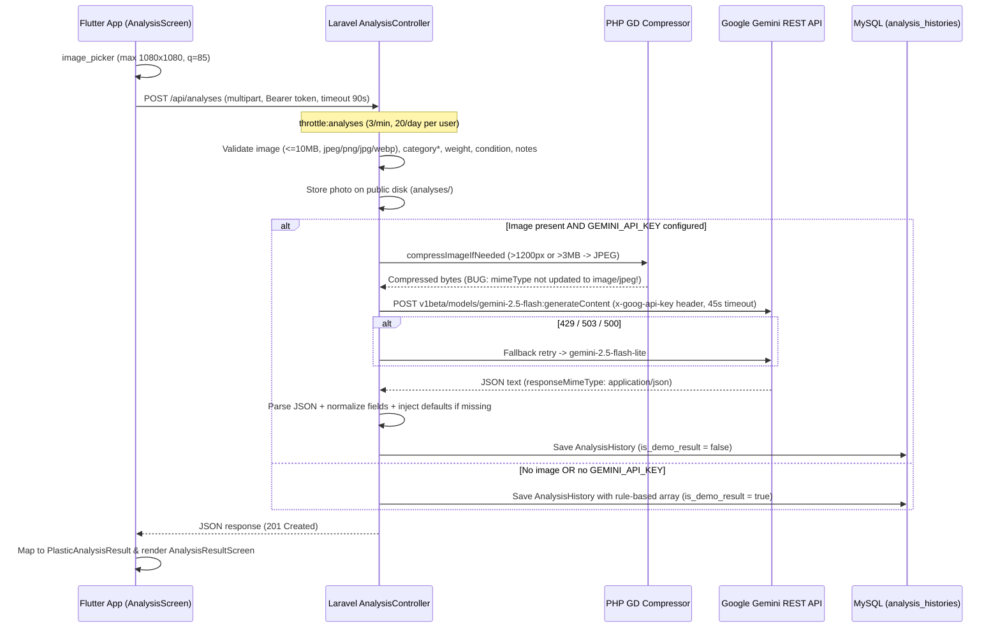

# Plasvora — AI Implementation, Matching & Claim Integrity Audit

**Objective:** Verify with strict engineering honesty what in Plasvora is **real AI**, what is **deterministic rule-based logic**, what is **standard non-AI API integration**, where AI bugs/risks exist, and how to accurately present Plasvora's AI to a technical jury or senior engineer.

---

## 1. Ground-Truth Classification of Every System Component

| Feature / Subsystem | Classification | Actual Implementation | Evidence |
|---|---|---|---|
| **Plastic Photo Analysis (`POST /api/analyses` with image + `GEMINI_API_KEY`)** | **Real External Generative AI (Multimodal LLM)** | Calls Google Gemini REST API (`gemini-2.5-flash` primary, `gemini-2.5-flash-lite` fallback) with base64-encoded image + structured Indonesian JSON prompt (`responseMimeType: application/json`). | `app/Services/GeminiVisionService.php:18-48,256-360`, `config/services.php` |
| **Plastic Analysis Fallback (`POST /api/analyses` without image OR without `GEMINI_API_KEY`)** | **Deterministic Rule-Based Fallback (`is_demo_result: true`)** | Returns hardcoded recommendations per polymer category from backend arrays (`PET`, `HDPE`, `PP`, `LDPE`, `OTHER`, `MIXED`) and flags `is_demo_result: true`. | `app/Http/Controllers/Api/AnalysisController.php:110-169,241-355` |
| **Flutter Offline Analysis Mode (`--dart-define=USE_API=false`)** | **Local Static Mock (`isSimulated: true`)** | `MockAnalysisRepository` returns hardcoded canned results; never runs in default `USE_API=true` builds. | `lib/main.dart:40`, `lib/repositories/analysis_repository.dart:332-580` |
| **Smart Matching (`/api/materials/{id}/matches`, `/api/material-requests/{id}/matches`)** | **Deterministic Rule-Based Scoring (NOT AI/ML)** | Fixed weighted formula in PHP: Category `40 pts` + Weight `30 pts` + Condition `20 pts` + Location `10 pts` = `100 pts`. Explicitly disclosed in API & UI as non-AI. | `app/Services/MaterialMatchingService.php:1-212`, `lib/views/matching/matching_results_screen.dart:286-297` |
| **Environmental Impact Summary (`GET /api/impact-summary`)** | **Real-Time SQL Database Aggregation (NOT AI)** | Aggregates `MaterialListing`, `HandoverRequest`, and `Order` rows directly from MySQL with handover/order deduplication. | `app/Http/Controllers/Api/ImpactSummaryController.php:26-111` |
| **Avoided Emission (`Emisi Terhindar`) on Analysis Results** | **LLM Free-Text / Hardcoded Static Estimates (NOT Verified LCA)** | Either free-form text generated by Gemini or hardcoded constants (`~1.5`–`~2.1 kg CO₂/kg`) without cited LCA methodology or actual verified mass calculation. | `GeminiVisionService.php:676-679`, `lib/repositories/analysis_repository.dart:98,285-309` |
| **Shipping Estimates, Payments, Marketplace, Gallery, Auth** | **Standard Non-AI Backend & Third-Party APIs** | RajaOngkir/Komerce REST API, Midtrans Snap/Core API, Laravel Eloquent CRUD, Sanctum Auth. | `RajaOngkirService.php`, `MidtransService.php`, `GalleryWorkController.php` |
| **On-Device ML / Custom Trained Models** | **NONE** | Zero TFLite, PyTorch Mobile, ONNX, ML Kit, or custom-trained weights exist in either repository. | `pubspec.yaml:30-43`, `composer.json` |

---

## 2. End-to-End AI Execution Flow (Verified in Source)

*\*Note: `BUG-02` currently causes 422 rejection whenever the user picks any category in Flutter's dropdown because Flutter sends `'1'`–`'7'` instead of `'PET'`..`'MIXED'`.*

---

## 3. Confirmed AI Bugs, Safety Gaps & Misleading Claims

| ID | Severity | Repo | File:Line | Finding |
|---|---|---|---|---|
| `AI-BUG-01` | **HIGH** | BE | `app/Services/GeminiVisionService.php:74-75,258,496` | **Compressed PNG/WebP MIME-Type Mismatch:** `compressImageIfNeeded()` always re-encodes large images (`>1200px` or `>3MB`) as JPEG via `imagejpeg()`, but `$mimeType` is passed by value and never updated to `image/jpeg`. Gemini receives JPEG bytes labeled `image/png` or `image/webp`, causing HTTP 400 decoding failures. |
| `AI-SAFE-01` | **HIGH** | FE | `lib/views/analysis/analysis_result_screen.dart:910-938,1536-1569`, `lib/repositories/analysis_repository.dart:251-257` | **Hazardous Melting Safety Gap:** `AnalysisResultScreen` displays `Karakter Titik Leleh` with **no persistent safety warning** against heating/melting toxic plastics (PVC #3 emits HCl/dioxins; PS #6 emits styrene; unknown mixes emit toxic fumes). Worse, client fallback `_defaultIdeas()` recommends **`"Dileburkan menjadi tatakan meja, stool, atau ubin komposit"`** with `safetyNotes: null`! |
| `AI-CLAIM-01` | **HIGH** | FE+BE | `analysis_screen.dart:115`, `analysis_result_screen.dart:175,255-257`, `ActivityController.php:128`, `create_material_listing_screen.dart:281,293` | **Misleading AI Badges & Version Numbers:** Hardcodes `'COMPUTER VISION MODEL V2.4'` and `'AI Vision v2.4'` (fabricating a non-existent version string and displaying `'AI Vision v2.4'` on photos **even when `isSimulated == true`**). `ActivityController.php:128` logs `"Analisis AI untuk: ..."` even for `is_demo_result == true` rows, and `CreateMaterialListingScreen` writes `"Material hasil analisis AI Plasvora"` even for simulated results. |
| `AI-CLAIM-02` | **MEDIUM** | FE+BE | `GeminiVisionService.php:676-679`, `analysis_repository.dart:98,285-309`, `analysis_result_screen.dart:881-994` | **Unsubstantiated CO₂ (`Emisi Terhindar`) Claims:** Displays LLM free-text or hardcoded static strings (`~1.5` to `~2.1 kg CO₂/kg`, missing `(Estimasi)` in rule-based switch) without LCA methodology, contradicting the project's own design spec (`Prompt_Google_Stitch_Plasvora.md:68`). |
| `AI-CLAIM-03` | **MEDIUM** | FE | `lib/views/home/home_screen.dart:524-546`, `lib/repositories/material_repository.dart:331-335` | **Misleading `"Bulan ini"` Time-Scope Label:** Home `Jejak Kontribusi` displays a non-interactive `"Bulan ini"` pill over **all-time cumulative** backend totals (`GET /api/impact-summary` accepts no date filter). |
| `AI-CLAIM-04` | **MEDIUM** | FE | `lib/views/analysis/analysis_screen.dart:828` | **Inaccurate Privacy Claim:** Claims *"Pemrosesan citra aman & tidak disebarluaskan"*, while images are stored on Laravel's unauthenticated `public` disk (`SEC-BE-04`) and transmitted to Google's external Gemini API. |
| `AI-SEC-01` | **MEDIUM** | BE | `GeminiVisionService.php:132-134,336`, `AnalysisController.php:82,182` | **Prompt Injection & Raw Upstream Error Disclosure:** Up to 1,000 chars of untrusted user `notes` are concatenated directly into the prompt without delimiter isolation; Gemini HTTP 400 error text is returned directly to clients. |
| `AI-MATCH-01` | **MEDIUM** | BE | `app/Services/MaterialMatchingService.php:40-43,72-75,196-211` | **Smart Matching Logic Flaws (Deterministic, Not AI):** (1) Does not exclude requester's own listings or owner's own requests (self-matching); (2) location prefix check `explode(' ', $loc)[0]` falsely awards partial score (`+5`) to `"Kota Bandung"` vs `"Kota Surabaya"` because both start with `"kota"`; (3) unbounded `->get()` loads all rows in category into memory. |
| `AI-UX-01` | **LOW** | FE | `lib/views/analysis/analysis_result_screen.dart:852-855,1660-1759` | Component verification dialog hardcodes bottle/cap instructions for every object type; post-analysis Marketplace CTAs ignore detected polymer and don't pass filter/matching params. |
| `AI-UX-02` | **LOW** | FE | `lib/views/matching/matching_results_screen.dart:268-301,503-583` | Backend's `res.note` and `match.scoreExplanation` are parsed but never rendered; `_buildListingMatchCard` lacks tap navigation and hardcodes green score badge color. |

---

## 4. AI Reliability, Cost, Latency & Privacy Assessment

- **API Key Protection:** **STRONG.** `GEMINI_API_KEY` exists solely on the Laravel backend (`config/services.php`), passed via `x-goog-api-key` HTTP header (never in URL query string, never in Flutter).
- **Abuse & Cost Control:** **GOOD.** `POST /api/analyses` requires Sanctum auth and enforces `throttle:analyses` (`3 req/min` and `20 req/day` per user). Fallback model `gemini-2.5-flash-lite` lowers cost/latency during 429/503 spikes.
- **Latency & Timeouts:** Backend sets `connectTimeout(10s)` + `timeout(45s)` (up to ~90s worst-case if primary times out and fallback runs); Flutter multipart client timeout is `90s` (`api_client.dart:361`), matching worst-case backend execution.
- **Failure Handling & Silent Fallbacks:**
  - When `GEMINI_API_KEY` is configured and Gemini fails (400/429/500/503/timeout), `AnalysisController` returns a proper HTTP error rather than silently faking an AI result — **good honesty**.
  - However, if Gemini returns partial JSON (missing `melting_point`, `avoided_emission`, `components`, or `recommendations`), both backend (`GeminiVisionService.php:676-690`) and Flutter (`analysis_repository.dart:97-99,188-190`) silently fill hardcoded defaults, including the unsafe melting fallback in Flutter.
- **Privacy Disclosure:** Sending user photos to Google Gemini API is normal for cloud Vision AI, but the app must disclose external AI processing accurately and move saved photos off Laravel's `public` disk (`SEC-BE-04`).

---

## 5. Strict Separation: AI in the Product vs. AI in Development

| Dimension | Factual Repository Evidence |
|---|---|
| **AI in the Product (Runtime)** | **Only one runtime AI feature exists:** server-side plastic photo analysis via Google Gemini Vision API (`gemini-2.5-flash` / `gemini-2.5-flash-lite`) invoked through `POST /api/analyses`. Smart Matching is deterministic PHP rule scoring (40/30/20/10). Impact Summary is SQL aggregation. All other features are non-AI transactional CRUD. |
| **AI Used During Development (Tooling)** | Repository documents clearly reflect AI-assisted design and engineering workflows: `Prompt_Google_Stitch_Plasvora.md` (UI design generation via Google Stitch), `Prompt_Antigravity_Plasvora.md` & `README_FOR_TEAM.md` (Flutter implementation workflow), `BACKUP_MANIFEST.md` (52 iterative backup logs), and inline Stitch UI comments (`analysis_result_screen.dart:1232,1371`). **Important:** Development-time AI assistance is engineering tooling, NOT runtime product AI, and should never be conflated when answering technical jury questions. |

---

## 6. Honest Jury Defense & Q&A Guide

### Answers to the 7 Core Technical Jury Questions

1. **"Does Plasvora really use AI?"**
   - **Honest Answer:** *"Yes—specifically for our plastic waste photo analysis feature. When a user uploads a photo, our Laravel backend sends the image and user-provided context to Google's Gemini Vision API (`gemini-2.5-flash`, with `gemini-2.5-flash-lite` fallback) using structured JSON output to identify the object, estimate polymer components, and suggest upcycling ideas. Other features like Smart Matching and Impact Tracking intentionally use deterministic backend algorithms and database queries rather than AI."*

2. **"Which exact features use AI and which do not?"**
   - **Uses AI:** Plastic Photo Analysis (`POST /api/analyses` when an image is uploaded and Gemini is configured).
   - **Deterministic Rule-Based (NOT AI):** Smart Matching (transparent 40/30/20/10 weighted scoring across category, weight, condition, and location), plus the no-image/demo analysis fallback (`is_demo_result: true`).
   - **Pure Transactional / SQL / Third-Party APIs (NOT AI):** Marketplace listings & requests, Checkout & Midtrans payments, RajaOngkir shipping quotes, Gallery of user works, Activity timeline, and Impact Summary database aggregates.

3. **"Did you train your own AI model or use an external AI API?"**
   - **Honest Answer:** *"We use an external pretrained multimodal foundation model via the Google Gemini Vision API (`gemini-2.5-flash`), orchestrated through our Laravel backend with structured JSON prompting, server-side response normalization, rate limiting, and fallback handling. We did not train a custom computer vision model or run on-device ML weights."*

4. **"Why use Gemini Vision instead of training a custom computer vision model?"**
   - **Honest Answer:** *"Plastic waste in real households is highly diverse—mixed lighting, partial labels, multi-component objects (e.g., PET bottle + HDPE cap + PP label)—and our feature needs two things simultaneously: visual object/component recognition and contextual Indonesian upcycling guidance. Training a custom CNN/YOLO model to handle both open-world waste detection and structured DIY recommendations would require a large labeled dataset plus a separate recommendation engine. Using Gemini Vision via a backend service lets us deliver an accurate MVP quickly while keeping our architecture decoupled (`GeminiVisionService`) so we can later swap in or combine a fine-tuned lightweight classifier if volume warrants it."*

5. **"Is Smart Matching AI?"**
   - **Honest Answer:** *"No—Smart Matching is a transparent, deterministic rule-based scoring engine on our backend: 40 points for polymer category match, 30 points for weight compatibility, 20 points for material condition, and 10 points for location proximity. We explicitly label it in the UI as `'Smart Matching Berbasis Aturan — Bukan probabilitas AI'` so users understand exactly why a listing ranked high."*

6. **"How do you handle AI inaccuracies, hallucination, or unsafe plastic processing recommendations?"**
   - **Honest Answer:** *"First, our prompt enforces structured JSON output, asks the model to break down multi-part objects (body vs. cap vs. label), and frames polymer identification as an estimation—prompting users to verify physical resin codes on the plastic. Second, we strictly separate AI output from transactional truth: marketplace listings, weights, shipping, and orders are always user-confirmed and server-validated. Third, our audit identified gaps we are actively closing: isolating user notes with prompt delimiters, removing generic melting fallbacks, and adding a persistent thermal-safety warning against heating PVC (#3), PS (#6), or unverified plastics."*

7. **"What happens when the AI API fails or is offline?"**
   - **Honest Answer:** *"Our backend enforces a 45-second timeout and automatically retries transient 429/503/500 errors on `gemini-2.5-flash-lite`. If both fail, the backend returns a clear error instead of silently pretending a fake result came from AI. If a user submits without a photo (or in an environment without an API key), the backend falls back to deterministic rule-based recommendations explicitly tagged with `is_demo_result: true` so the UI displays a simulation banner."*

---

### Ready-to-Use Pitch & Defense Scripts

#### 30-Second Version (Elevator / Demo Intro)
> "Plasvora combines a Flutter mobile app and Laravel backend to turn household plastic waste into circular value. Our flagship plastic scanner uses Google's **Gemini Vision API** (`gemini-2.5-flash`) through our Laravel server to analyze user photos, break down polymer parts, and generate upcycling ideas. Everything else—our 40/30/20/10 Smart Matching engine, RajaOngkir shipping, Midtrans checkout, and real-time database impact metrics—is intentionally deterministic so pricing, matching, and environmental counts stay transparent and auditable."

#### 1-Minute Version (Competition Jury Presentation)
> "In Plasvora, we intentionally use AI only where multimodal reasoning genuinely adds value, and deterministic engineering everywhere else. When a user scans plastic waste, the Flutter app sends a compressed image to our Laravel backend—keeping API keys off the client and enforcing per-user rate limits (3/min, 20/day). Laravel invokes Google Gemini Vision (`gemini-2.5-flash` with `gemini-2.5-flash-lite` failover) in JSON mode to estimate the object, its polymer components, and actionable DIY ideas, while clearly flagging no-image fallbacks as simulated rules. Downstream, Smart Matching uses an explicit 40/30/20/10 rule-based score rather than black-box ML, paid orders use server-authoritative pricing and locked transactions with Midtrans SHA-512 webhook verification, and impact counters aggregate live database records rather than guessed numbers."

#### Senior Software Engineer Technical Explanation
> "The AI integration is strictly server-side behind `AnalysisController` -> `GeminiVisionService` (zero client keys, zero on-device ML dependencies). `POST /api/analyses` is Sanctum-authenticated and throttled (`throttle:analyses`: 3/min, 20/day). The service sends base64 `inlineData` with `responseMimeType: application/json`, 10s connect / 45s request timeout, and automatic failover from `gemini-2.5-flash` to `gemini-2.5-flash-lite` on 429/500/503, followed by defensive JSON normalization. Known engineering gaps from our audit—a GD JPEG-vs-MIME mismatch on compressed PNG/WebP uploads, prompt delimiter hardening for user `notes`, moving `analyses/` images to private storage, fixing the Flutter `'1'`–`'7'` dropdown contract mismatch, and removing inaccurate `'AI Vision v2.4'` and unverified CO₂ copy—are scoped in our P0/P1 remediation plan."
